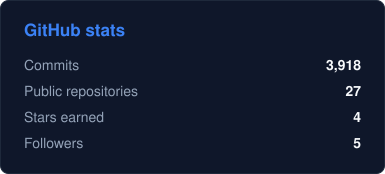
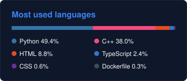
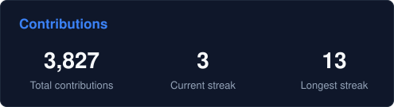

# Shashank Singh

I build C++ engines, Python backends and applied AI tools. Final-year Computer Science (AI) student at the University of Lucknow, open to software engineering and data science roles.

You can find me on my [portfolio](https://shashank17singh.github.io/), [LinkedIn](https://linkedin.com/in/shashank17singh) and [Codolio](https://codolio.com/profile/Shashank17singh), or write to [shashanksingh1709@gmail.com](mailto:shashanksingh1709@gmail.com).

---

## Six projects, two of them live

| Project | What it does | Built with | Try it |
| :------ | :----------- | :--------- | :----- |
| [Hotseat](https://github.com/Shashank17singh/Hotseat) | A spoken mock interview that builds questions from your resume, follows up on your answers and scores each one. | Next.js, TypeScript, Groq, Whisper | [Live](https://hotseat-black-chi.vercel.app/) |
| [UPI-Mesh](https://github.com/Shashank17singh/UPI-Mesh) | An offline-first payments backend with hybrid RSA-2048 and AES-256-GCM encryption, relayed over a simulated Bluetooth mesh, with ciphertext-hash idempotency against replays. | Python, FastAPI, SQLite, Docker | [Live](https://upi-mesh.duckdns.org/) |
| [CodeSync](https://github.com/Shashank17singh/CodeSync) | A browser code editor where a whole room types in one file, with live cursors, chat, history, sandboxed runs under gVisor and an online judge. | React, TypeScript, Yjs, Fastify, PostgreSQL, Redis | Source |
| [CampusMind](https://github.com/Shashank17singh/CampusMind) | A college assistant that answers from official documents with citations, and plans study schedules and reminders through agents. | Python, FastAPI, LangGraph, React, PostgreSQL, Qdrant | Source |
| [DPI Engine](https://github.com/Shashank17singh/DPI-Engine) | A C++17 deep packet inspection engine that rebuilds TCP and UDP flows and classifies traffic by TLS SNI and HTTP Host, keeping each flow on one thread with consistent hashing. | C++17, libpcap, multithreading | [Output](https://drive.google.com/file/d/10SGNof9nAoBBDV3tLYXItznoQME83Urs/view?usp=sharing) |
| [Your-Own-AI](https://github.com/Shashank17singh/Your-Own-AI) | A C++ vector database with KD-Tree and HNSW indexes, REST APIs for its dashboard, and a local RAG pipeline on Ollama. | C++, CMake, HNSW, Ollama | [Architecture](https://drive.google.com/file/d/1Girgrfgo7ZIKBKfR50Lx9Uw5mkTW6ml0/view?usp=sharing) |

---

## What I work with

| Area | Tools |
| :--- | :---- |
| Languages | Python, C++, TypeScript, SQL |
| AI and machine learning | PyTorch, LangChain, Hugging Face, Qdrant, ChromaDB, Scikit-learn, XGBoost |
| Systems and backend | C++17, multithreading, FastAPI, Flask, REST APIs, PostgreSQL, Supabase |
| Architecture and security | Distributed systems, microservices, TCP/UDP/TLS, cryptography (RSA/AES) |
| Cloud and DevOps | Docker, AWS, CI/CD, GitHub Actions, Nginx |

---

 

